

  <picture>
    <source media="(prefers-color-scheme: dark)" srcset=".github/assets/facet-logo-dark.svg">
    <source media="(prefers-color-scheme: light)" srcset=".github/assets/facet-logo-light.svg">
    
  </picture>

  Wall panel UI for Home Assistant. 
  One C++/LVGL renderer that runs on ESP32 touch panels and, compiled to WebAssembly, in the browser.

  <a href="https://mrdarrengriffin.github.io/facet/"><picture><source media="(prefers-color-scheme: dark)" srcset=".github/assets/pill-docs-dark.png"></picture></a> &nbsp;
  <a href="https://mrdarrengriffin.github.io/facet/components/"><picture><source media="(prefers-color-scheme: dark)" srcset=".github/assets/pill-components-dark.png"></picture></a> &nbsp;
  <a href="https://mrdarrengriffin.github.io/facet/roadmap/"><picture><source media="(prefers-color-scheme: dark)" srcset=".github/assets/pill-roadmap-dark.png"></picture></a>

 

  <a href="https://mrdarrengriffin.github.io/facet/screens/"><picture><source media="(prefers-color-scheme: dark)" srcset=".github/assets/screens-dark.png">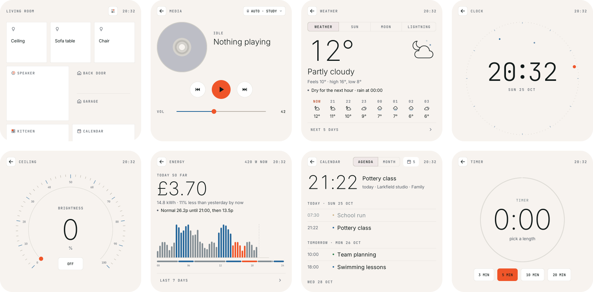</picture></a>

Rendered by the same code that runs on the panel. Docs and design system: <a href="https://mrdarrengriffin.github.io/facet/">mrdarrengriffin.github.io/facet</a>

 

> **Everything here is a work in progress.** Facet is being built actively: new screens are still
> being made and existing ones change as they get used on real panels, so expect things to move
> around. The [docs site](https://mrdarrengriffin.github.io/facet/) runs the renderer live in your browser: every component and screen
> there is the real thing, not a picture of it.

## <picture><source media="(prefers-color-scheme: dark)" srcset=".github/assets/icon-light-dark.svg"><source media="(prefers-color-scheme: light)" srcset=".github/assets/icon-light-light.svg"></picture>&nbsp; The idea

A small screen in every room, each one showing what matters in that room right now: the music
that's playing, a kitchen timer, the lights, the next thing in the calendar. When nothing needs
you, the screen goes quiet.

- Glanceable from across the room
- Big touch targets, one action per card
- Small, purposeful animations and sounds
- Built for the panel: every colour designed for 16-bit displays, every redraw kept small

## <picture><source media="(prefers-color-scheme: dark)" srcset=".github/assets/icon-settings-dark.svg"><source media="(prefers-color-scheme: light)" srcset=".github/assets/icon-settings-light.svg"></picture>&nbsp; How it works

Facet is one renderer, written in C++ on [LVGL](https://lvgl.io). The same source builds two ways:

- **On the panel**, as an ESPHome external component (`firmware/`). The panel reads Home Assistant
  itself, and fetches public data (weather, moon, energy prices) on its own while a screen is visible.
- **In the browser**, compiled to WebAssembly. The docs site and the workbench use this build, so
  what you see there is pixel for pixel what the panel draws.

Everything is built from one set of tokens (colour, type, space, layout, motion, sound) and one set
of components, so every screen looks and behaves the same at either size.

**Specs.** Screens are JSON specs: a tree of real components with bindings to entities
(`renderer/specs/`). A spec names what to show, not how to draw it, so a new screen is a new
arrangement of components you already have.

**Send API.** A panel running Facet has a small HTTP API, so you can show something on it from
anywhere:

| Endpoint | What it does |
|---|---|
| `POST /fw/show` | show a component or screen with props: `{"id": "spec", "props": {"screen": "weather"}}` |
| `POST /fw/spec` | send a screen spec to draw |
| `POST /fw/deck` | send the panel's set of screens |
| `GET /fw/info`, `/fw/meta` | what the panel runs and what it can show |

Changes from anywhere but the panel's own editor are gated behind an **Allow AI agents** switch on the
device (off by default) and a per-panel token. AI agents start at the panel's `/llms.txt`.

## <picture><source media="(prefers-color-scheme: dark)" srcset=".github/assets/icon-home-dark.svg"><source media="(prefers-color-scheme: light)" srcset=".github/assets/icon-home-light.svg"></picture>&nbsp; Screens

Each screen has a page in the docs with a live preview you can tap and drag, what it shows and the
data it reads.

<table>
<tr>
<td width="50%" valign="top">
<a href="https://mrdarrengriffin.github.io/facet/screens/home/"><picture><source media="(prefers-color-scheme: dark)" srcset=".github/assets/screen-home-dark.png">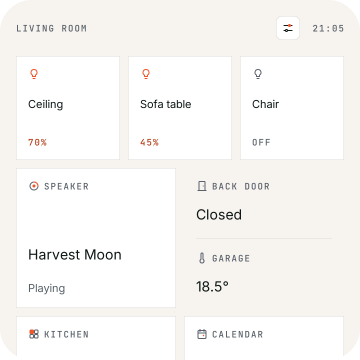</picture></a>

<a href="https://mrdarrengriffin.github.io/facet/screens/home/"><b>Home</b></a> 
The room's cards, each one a way into a screen.

</td>
<td width="50%" valign="top">
<a href="https://mrdarrengriffin.github.io/facet/screens/media/"><picture><source media="(prefers-color-scheme: dark)" srcset=".github/assets/screen-media-dark.png">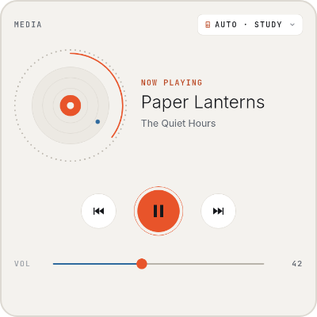</picture></a>

<a href="https://mrdarrengriffin.github.io/facet/screens/media/"><b>Media</b></a> 
Now playing on a spinning disc, with transport controls and live volume.

</td>
</tr>
<tr>
<td width="50%" valign="top">
<a href="https://mrdarrengriffin.github.io/facet/screens/light/"><picture><source media="(prefers-color-scheme: dark)" srcset=".github/assets/screen-light-dark.png">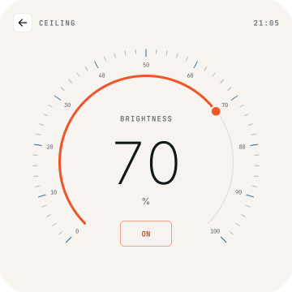</picture></a>

<a href="https://mrdarrengriffin.github.io/facet/screens/light/"><b>Light</b></a> 
One light on a dial: drag the ring for brightness, tap to switch it.

</td>
<td width="50%" valign="top">
<a href="https://mrdarrengriffin.github.io/facet/screens/covers/"><picture><source media="(prefers-color-scheme: dark)" srcset=".github/assets/screen-covers-dark.png">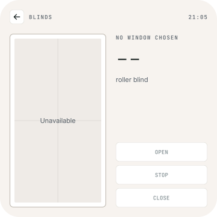</picture></a>

<a href="https://mrdarrengriffin.github.io/facet/screens/covers/"><b>Blinds and curtains</b></a> 
Open, close or set a position for blinds and curtains.

</td>
</tr>
<tr>
<td width="50%" valign="top">
<a href="https://mrdarrengriffin.github.io/facet/screens/clock/"><picture><source media="(prefers-color-scheme: dark)" srcset=".github/assets/screen-clock-dark.png">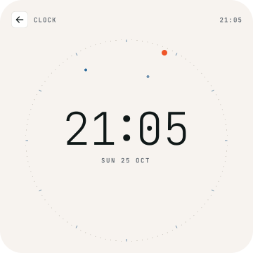</picture></a>

<a href="https://mrdarrengriffin.github.io/facet/screens/clock/"><b>Clock</b></a> 
The time as the one hero on the screen. Also the idle screen.

</td>
<td width="50%" valign="top">
<a href="https://mrdarrengriffin.github.io/facet/screens/timer/"><picture><source media="(prefers-color-scheme: dark)" srcset=".github/assets/screen-timer-dark.png">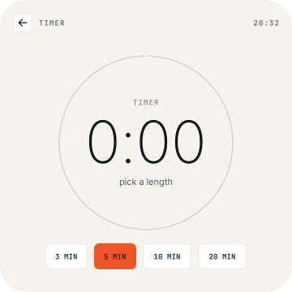</picture></a>

<a href="https://mrdarrengriffin.github.io/facet/screens/timer/"><b>Timer</b></a> 
A running timer as the hero, with one-tap lengths when nothing is running.

</td>
</tr>
<tr>
<td width="50%" valign="top">
<a href="https://mrdarrengriffin.github.io/facet/screens/weather/"><picture><source media="(prefers-color-scheme: dark)" srcset=".github/assets/screen-weather-dark.png">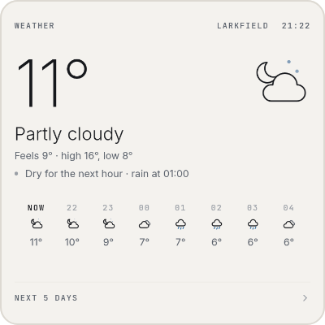</picture></a>

<a href="https://mrdarrengriffin.github.io/facet/screens/weather/"><b>Weather</b></a> 
The temperature, one line, rain in the next hour and the hours ahead.

</td>
<td width="50%" valign="top">
<a href="https://mrdarrengriffin.github.io/facet/screens/moon/"><picture><source media="(prefers-color-scheme: dark)" srcset=".github/assets/screen-moon-dark.png">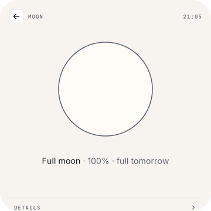</picture></a>

<a href="https://mrdarrengriffin.github.io/facet/screens/moon/"><b>Moon</b></a> 
Tonight's moon phase, worked out on the panel with no API.

</td>
</tr>
<tr>
<td width="50%" valign="top">
<a href="https://mrdarrengriffin.github.io/facet/screens/calendar/"><picture><source media="(prefers-color-scheme: dark)" srcset=".github/assets/screen-calendar-dark.png">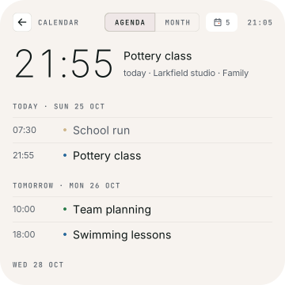</picture></a>

<a href="https://mrdarrengriffin.github.io/facet/screens/calendar/"><b>Calendar</b></a> 
What's next, then today and the days ahead as an agenda or a month.

</td>
<td width="50%" valign="top">
<a href="https://mrdarrengriffin.github.io/facet/screens/energy/"><picture><source media="(prefers-color-scheme: dark)" srcset=".github/assets/screen-energy-dark.png">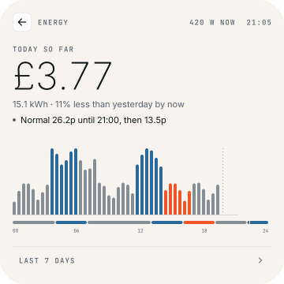</picture></a>

<a href="https://mrdarrengriffin.github.io/facet/screens/energy/"><b>Energy</b></a> 
Today's cost so far, the price you're on and today's half-hours.

</td>
</tr>
</table>

More screens are on the way (thermostat, lock, vacuum, cameras, plants and others): see the
[roadmap](https://mrdarrengriffin.github.io/facet/roadmap/).

## Panels

| Panel | Screen | Status |
|---|---|---|
| Waveshare ESP32-P4-86 | 4", 720 x 720 | In progress |
| Guition ESP32-4848S040 | 4", 480 x 480 | In progress |

Both panels get the same layout: the 480 panel is the reference size, the 720 panel draws it at 1.5x.
Other sizes are planned.

## Repository

| Folder | What |
|---|---|
| `renderer/` | the C++/LVGL renderer: core, foundations, components, screens, specs, tokens and the tools that check them. Developer notes: [renderer/README.md](renderer/README.md) |
| `firmware/` | the ESPHome external component and the bundler that packs the renderer into it |
| `site/` | the docs site (Astro), generated from what the renderer registers |

The earlier Facet, a TypeScript design system with the same screens, lives on the
[`prototype`](https://github.com/mrdarrengriffin/facet/tree/prototype) branch.

## Inspiration

Facet learns a lot from other open-source panel projects, and they're well worth a look:

- [ESPControl](https://github.com/jtenniswood/espcontrol) by jtenniswood, an ESPHome-based smart
  home control panel, especially if you want a panel you can set up today:
  [jtenniswood.github.io/espcontrol](https://jtenniswood.github.io/espcontrol/).
- [openHASP](https://github.com/HASwitchPlate/openHASP) by fvanroie and contributors, LVGL pages on
  touch panels driven over MQTT.

Facet isn't affiliated with these projects.

## Support

Facet is free and built in my spare time, with a lot of help from Claude. If it's useful to you,
a coffee helps cover the tokens: [Buy Me a Coffee](https://buymeacoffee.com/mrdarrengriffin) ·
[Ko-fi](https://ko-fi.com/mrdarrengriffin).

## Licence

MIT © Darren Griffin. Bundled fonts (Inter, JetBrains Mono) are under the SIL Open Font License.
