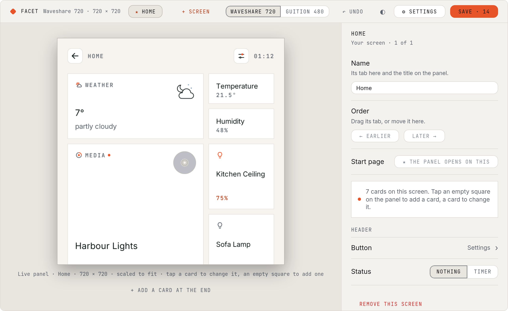
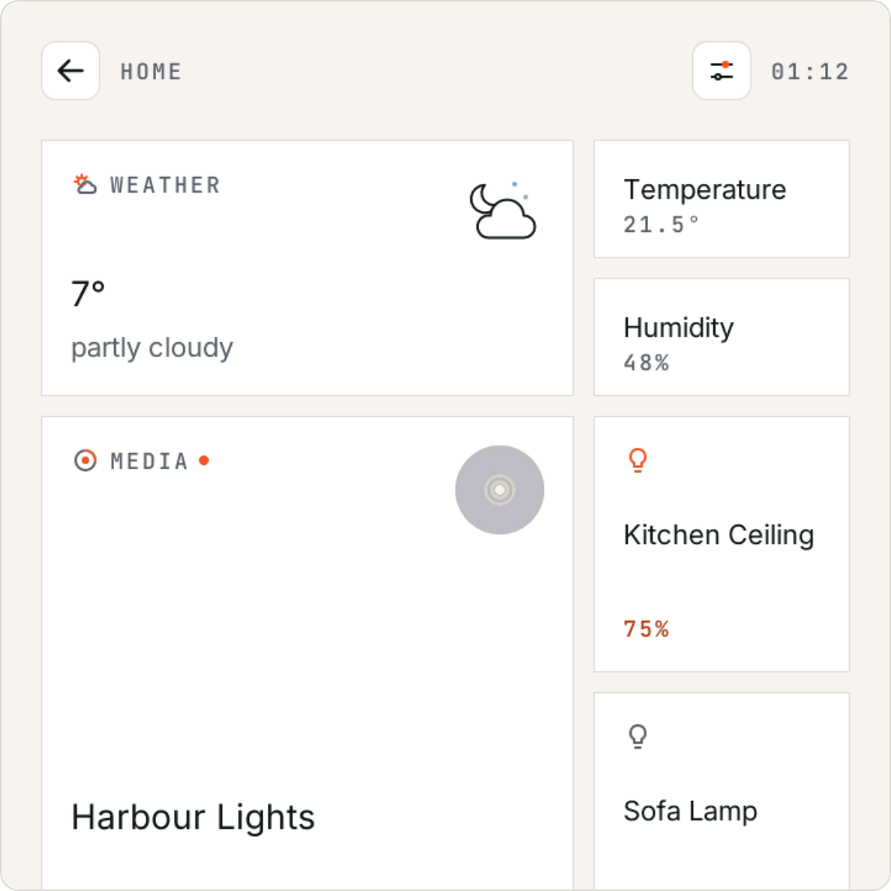
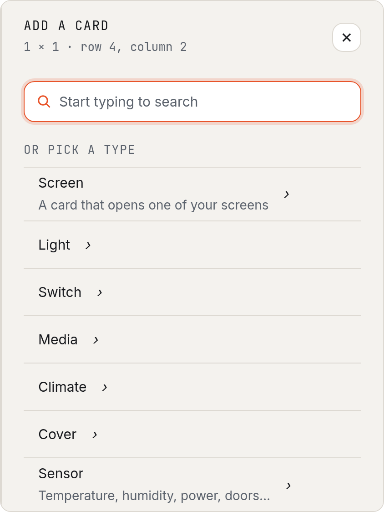
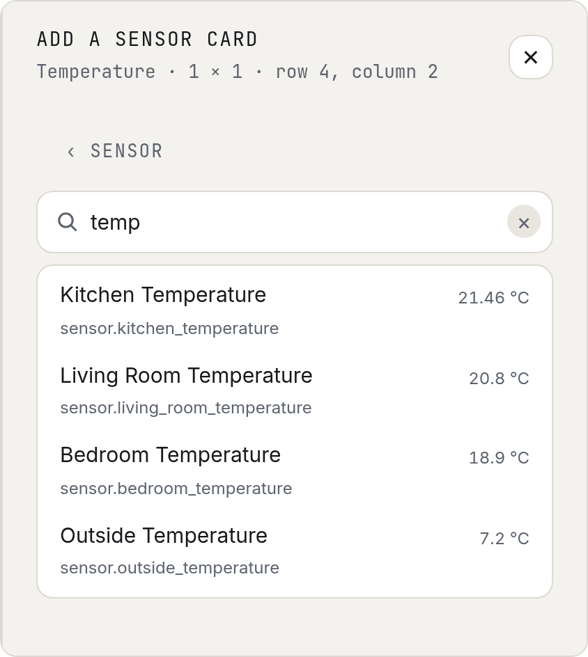

The first version of the new editor: build your own pages in a browser, on a live copy of your panel. More improvements and changes to the editor are coming in the next betas. Plus a few fixes.

## New

- **The new editor (first version).** Open `http://<your panel>/` on a computer or phone on the same Wi-Fi.
  - A live copy of the panel, drawn by its own renderer, with its own data: your lights, the flights overhead, the weather, your calendar.
  - Up to eight screens of your own: name them, order them, pick the one the panel opens on.
  - Built-in screens and their options are in **Settings > Screens**; **Settings** also has the look, text size, units and the Home Assistant link.
  - **Save** lists your changes in words and the panel checks them first; **Undo** puts the last save back; **Back to factory** starts again.
  - The first open after an update shows how far the download has got.
  - #82 #179 #180

  

- **Building pages, reworked.** Easier to customise: every card can be any size.
  - Sizes: **1 × 1** (a tile), **half** (two share one square), **2 × 1** and **2 × 2** (with the card's picture: the record for Media, the animated icon for Weather).
  - Tap an empty square to add a card; tap a card to change its size, what it shows and what a tap does, or to remove it. The cards after it move to fit.
  - #82

  

- **Add a card by type, then search.** Pick what it is first, then type: nothing is listed until you do.
  - Types: Screen, Light, Switch, Media, Climate, Cover, Sensor and Other. A Sensor asks what it measures: temperature, humidity, power, energy, battery, doors and windows, or motion.
  - Each match shows its value the way Home Assistant does: 21.5 °C, Open, Detected.
  - #178

   

- **Your entities, indexed for search.** Searching is instant as you type, even with thousands of entities.
  - The panel reads your entities from Home Assistant once, a few seconds in a large house, and hands the editor a compact index: id, name, what it measures and its value.
  - The index is read again in the background when it is over a minute old.
  - The panel keeps none of it once sent, and only uses memory it can spare.
  - #178
- **A fresh panel starts empty.** A new panel, or one put back to factory, is one empty Home that says where to open the editor. #82

## Fixed

- **Album art stopped loading on the Guition after a while.** Covers failed with "too big" once the panel's memory had broken into small pieces, and large covers never fitted.
  - Pictures now have their own memory, set aside at start-up.
  - A cover is decoded as it downloads, instead of being held whole first.
  - #175
- **The problem report let details about your home through.** It took out tokens, keys and passwords, but not everything that identifies a home.
  - Now also taken out: addresses, network names, Home Assistant entity names, links' hosts and queries, and your own screens' names.
  - The report page says it is safe to paste, in a notice at the top.
  - #176

## After updating

- **Your Home is laid out the new way.** Your cards keep their order.
  - Small cards become 1 × 1, medium 2 × 1 (a sensor's: half), large 2 × 2.
  - Cards no longer have their own on / off switch: a light card shows its level, and a tap does what you set (toggle, or open its screen).
  - To move or resize cards, open `http://<your panel>/` in a browser.

## Known issues

- **On / Off is missing on the Light screen for lights without dimming.** The ON / OFF button below the dial still works. #171
- **A 1 × 1 card for a media player says Off while it plays.** Use a 2 × 1 or bigger card for now. #182
- **The Calendar's big day can read as today's date.** Late in the day, with today's events over, it shows the next event's day ("Fri" on a Monday). #181
- **In the editor, taps that change a screen's own view do nothing.** Picking a plane on Overhead or opening a sheet works on the panel only. #180
