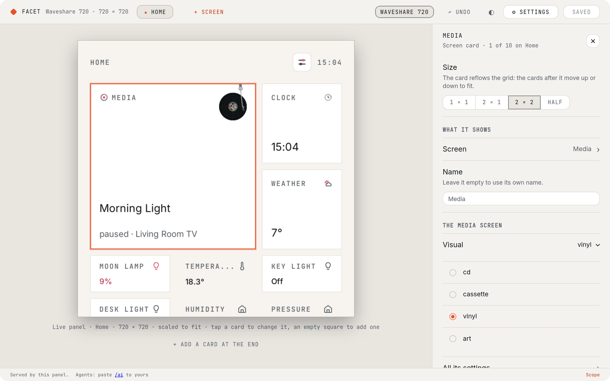
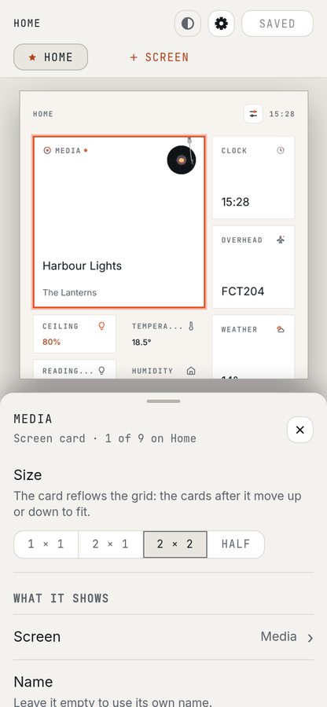
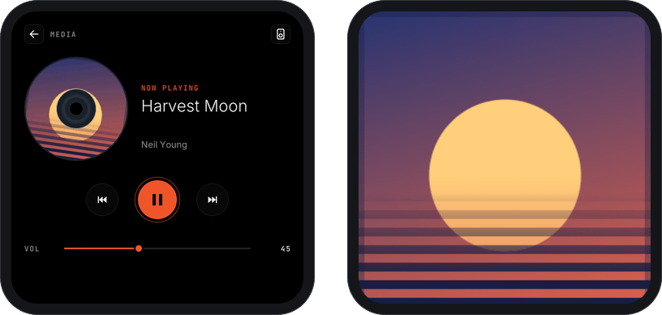
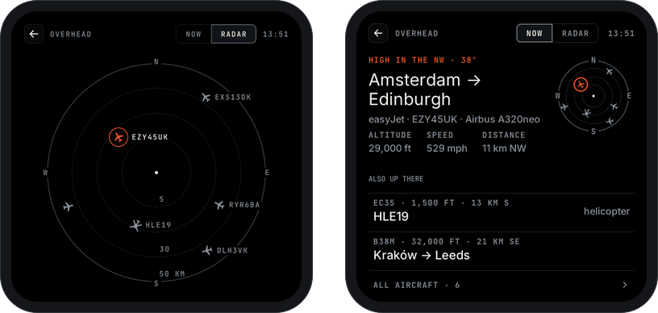
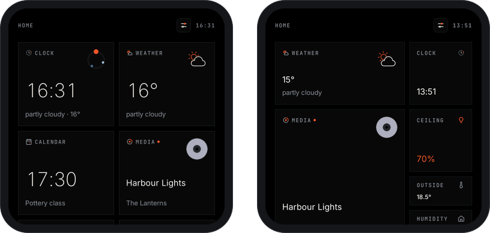
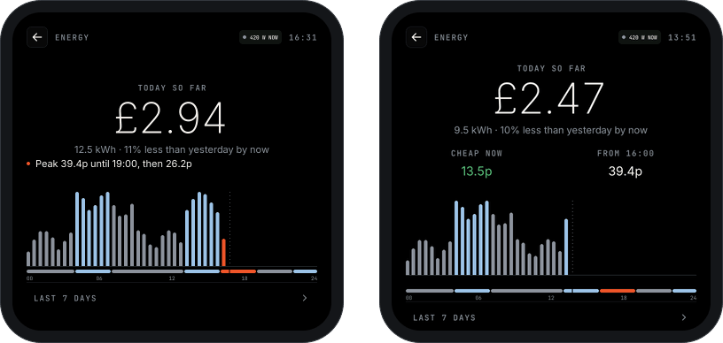

Facet 0.5 is the first release after ten betas. You can now arrange your panel from a browser, and music, flights and your Home cards look far better. The 480 panel is much steadier, and updates come on three channels: Release, Beta and Dev.

## ⭐ Highlights

### [Arrange your panel in a browser](https://mrdarrengriffin.github.io/facet/editor/)

Open `http://<your panel>/` on any computer or phone on the same Wi-Fi. #82 #179 #180 #189 #195 #206

- A live copy of the panel, drawn by its own renderer with your own data
- Drag, resize, add and remove cards (long press first on touch); up to eight screens of your own
- Save lists your changes in words, Undo puts the last save back, Back to factory starts over
- On a phone the panel stays in view and the settings open in a sheet you drag

 

### [Album art everywhere](https://mrdarrengriffin.github.io/facet/screens/media/)

The cover of what's playing, on the CD, the vinyl and Home's media cards. #91 #100 #101 #108 #115 #117 #130 #154 #175 #196 #201

- The record turns with it; a new Art visual shows it as a plain square
- Set Idle shows to Album art for a full-screen cover while music plays

### [Overhead: the aircraft over your home](https://mrdarrengriffin.github.io/facet/screens/overhead/)

A radar of the flights around you, with where each one is going, its height and speed. #124 #146 #155 #157 #160

- Free adsb.lol data with no account, or FlightRadar24 or your own ADS-B receiver through Home Assistant
- A list of every flight, a Home card, and their own shapes for helicopters and military jets

### [Home cards in four sizes](https://mrdarrengriffin.github.io/facet/screens/home/#cards)

1 × 1, half, 2 × 1 and 2 × 2, the big ones with a picture. #192 #193

- Same layout on every card: name top-left, icon top-right, state at the bottom
- A tap does what you set: toggle, or open its screen

Before and after

## ✨ New

- **[Add a card by type, then search](https://mrdarrengriffin.github.io/facet/editor/#add)**: pick Light, Media, Sensor and so on, and see every match with its value. #178 #190 #199
  - Instant search, even with thousands of entities
  - A new half-size State readout card for one sensor
- **[An idle screen](https://mrdarrengriffin.github.io/facet/screens/idle/)**: a dimmed clock (or the album art) at its own Idle brightness; the first tap goes Home. #116 #122 #153
- **[The panel's own Home Assistant link](https://mrdarrengriffin.github.io/facet/install/#link)**: scan a code in Settings > Home Assistant to give the panel its own address and token.
  - Used for album art, the editor's search, Energy and calendars; km or miles follow your country
- **[Media and Calendar set themselves up](https://mrdarrengriffin.github.io/facet/screens/media/)**: Media finds Music Assistant, Spotify, Google Cast and Sonos speakers and follows the one playing. #6 #7 #8 #210
  - [Calendar](https://mrdarrengriffin.github.io/facet/screens/calendar/) shows every calendar, each with an on/off on the screen
- **[Update channels](https://mrdarrengriffin.github.io/facet/help/versions/)**: pick Release, Beta or Dev in Settings > Update channel or in Home Assistant. #102 #106 #159
  - Settings > Update shows the version and installs; skipping versions lists the notes of each
- **[API keys for scripts and agents](https://mrdarrengriffin.github.io/facet/ai/)**: a script asks for a key by name, you allow it with a tap; Revoke all in Settings > API keys.
- **[Report a problem from the panel](https://mrdarrengriffin.github.io/facet/help/troubleshooting/#report)**: Settings > About gives a report page with the panel's logs, personal details taken out. #125 #176
- **[Reset pairing](https://mrdarrengriffin.github.io/facet/help/troubleshooting/#encryption-key)**: fixes "encryption key is invalid" after a restore; devices and entities are kept. #150
- **[An update password per panel](https://mrdarrengriffin.github.io/facet/help/troubleshooting/#update-password)**: needed for Wi-Fi flashing from ESPHome; Home Assistant and USB updates are unchanged. #149
- **[New Home cards](https://mrdarrengriffin.github.io/facet/screens/home/#cards)**: a Timer card, and an analogue face plus the date on the Clock card.

## 🛠️ Improved

- **A steadier 480 panel (Guition)**: far more free memory, so no more restarts with the editor open, a big card changing or album art loading. #118 #121 #152 #175 #185 <!-- no docs: nothing to set up -->
  - Album art keeps loading after days of running; the flickering band is gone
- **[Built-in screens are always there](https://mrdarrengriffin.github.io/facet/editor/#built-in)**: Clock, Weather, Calendar, Media, Energy, Moon, Overhead and Timer need no switching on. #177 #198
  - A screen's data only loads while it's shown or a Home card can open it
- **[Safer, quicker updates](https://mrdarrengriffin.github.io/facet/help/troubleshooting/#updates)**: a new firmware is kept only once it has run properly, or the panel goes back. #55 #148
  - No more stuck on Installing; a new version is seen straight away
- **[Energy follows your tariff](https://mrdarrengriffin.github.io/facet/screens/energy/)**: the cost comes from Home Assistant itself, so time-of-use tariffs are right. #62 #132 #133 #134 #162
  - Price now and next as values, saving sessions as a chip, and one missed read no longer blanks the screen

  
  Before and after
- **[Not found vs Unavailable](https://mrdarrengriffin.github.io/facet/screens/home/#unavailable)**: every screen tells a missing entity apart from one with no state.
  - Media, Calendar and Weather recover on their own after Home Assistant restarts
- **Faster screens**: eight screens are kept ready in the background, so most open at once. <!-- no docs: nothing to set up -->
- **[Tidier settings](https://mrdarrengriffin.github.io/facet/editor/#save)**: radio marks for one choice, checkboxes for many, and a refused change says why. #116
- **[Mouse wheel scrolling](https://mrdarrengriffin.github.io/facet/editor/)**: in the editor and the docs site's live panels. #204

## 🐛 Fixed

- **Taps during a screen build are no longer lost**: they happen as soon as it's ready. #94
- **Calendar settings show at once**, with no restart. #98
- **Text stays in its box** in the Blockcraft and Windows 98 themes, ending in "..." when it doesn't fit. #81
- **The Waveshare no longer goes black at low brightness**: Backlight runs from just visible at 1 % to full. #153

## 🧪 Since 0.5.0-beta.10

- **Calendar loads Home Assistant's calendars again**, in seconds after a restart. #203
- **Idle brightness works while idle**, from Home Assistant or the panel. #209
- **Idle album art stays up on the Guition** for the whole track. #197
- **Media follows the track, not the line-in**, when two players play. #210
- **The editor on a phone**: the panel stays in view; settings are a sheet you drag. #206
- **Mouse wheel scrolling** in the editor and docs. #204
- **Stable is now Release**, with a new Help > Versions page.

## ⬆️ After updating

- **Your settings, Home and cards are kept.** Cards take the new sizes in the same order; screens you switched off are back.
- **Link the panel to Home Assistant** (Settings > Home Assistant) for album art, search, Energy and calendars.
- **Media's speaker and Calendar's calendars** are now chosen on the screen itself.
- **Automations and scripts:** Clock after is now Idle after; the AI agent token is now API keys; Wi-Fi flashing needs the update password.
- **Blinds and curtains and Living room are gone for now.** They will come back later.

## ⚠️ Known issues

- **The Guition can flicker while the editor is open**: a frame can drop each time it reads the panel's status. #211
- **The Guition is still short of memory with many screens**: it says it is busy rather than restarting. #185
- **A 1 × 1 media card can say Off while it plays**: use a half or bigger card for now. #182
- **Calendar's big day can show the next event's day as today's**, late in the day once today's events are over. #181

All changes (71)

### Features (29)

- Media: the disc shows the album art #91
- Idle: full-screen album art while music plays #101
- Firmware: a dev channel built by CI from every commit on main #102
- Media: a square album-art visual #108
- Media: the vinyl and CD turn with their album art; the Disc visual folds into CD #115
- Media: the CD turns with its album art by default, lighter on the Guition #119
- Settings: drop the Home Assistant "Entity lists / Read now" row; pickers refresh their own lists #120
- Screens: Overhead, an aviation radar of the flights over your home #124
- Firmware: a problem report from the panel, with logs kept across restarts #125
- Images: hardware JPEG + PPA on the Waveshare, Apple Music art at the box size #130
- Energy: one connection per round and incremental statistics reads #133
- Firmware: a web read for the feeds' direct sources (core/net.h) on both boards #146
- Overhead flight radar settings: a clearer way to show where the radar is centred #155
- Overhead flight radar: show where each flight is going from and to, with every source #157
- Settings: tapping Update checks for an update, with Checking… and the result #159
- Overhead flight radar: helicopter and military jet icons #160
- Report: scrub identifiers, then say it is safe to paste #176
- Screens: no on / off; a built-in screen's data runs only while something uses it #177
- Editor: add a card by type, then search; never list every entity #178
- Editor: the first open after an update waits on the renderer download with no sign of progress #179
- Editor: screens show the panel's own data (feeds, forecasts, Energy), not just entity values #180
- Editor: quick way from a screen's card to that screen's settings #189
- Editor: Add card entity picker lists every matching entity before you search #190
- Clock card: show the digital time on every size #192
- Half cards: icon + label header like the 1x1 / 2x1, and fix alignment #193
- Editor: drag cards to move them on a screen #195
- Screens: remove "Card on Home" and the editor's "On Home" #198
- Editor: offer the State readout component as a half-size card #199
- Renderer in the browser: scroll with the mouse wheel / trackpad #204

### Fixes (40)

- Firmware: update entity stays on Installing after the reboot #55
- Components: sensor readout values vanish and don't come back #62
- Themes: text overflows its box in the Blockcraft and Win98 themes #81
- Firmware: taps during a page build are lost #94
- Calendar: calendars picked in screen settings show without a reboot #98
- Media: show the album art #100
- Images: decode remote pictures straight to their box, within a fixed memory budget #109
- Firmware: choosing the Dev update channel restarted a Guition and lost the choice #110
- Firmware: the update entity offers older builds, and a channel change can swap a running check's URL #111
- Dev builds: version by commit time so same-day builds are newer in Home Assistant #112
- Media screen: play / pause rebuilds the hero and the album art blinks #113
- Home card: play / pause rebuilds the media card and its album art blinks #114
- Settings: "Clock after" reads "Idle after" #116
- Images: the Guition's full-screen album art is pixelated #117
- Firmware: Guition screen flickers in a band halfway down, mostly when settings change #118
- Firmware: Guition software restart ends in the RTC watchdog #121
- Home Assistant: name the idle timeout entity "Idle after" #122
- Idle album art: alternate rows shifted (interlace) #127
- Firmware: screenshot fails for lack of memory since the idle art buffers #131
- Energy: keep the last good value through one failed read #132
- Energy: use Home Assistant's cost statistics, not kWh x current price #134
- Firmware: update checks get a stale manifest from the GitHub Pages cache #148
- Firmware: a per-panel OTA password on the public build #149
- Firmware: reset the Home Assistant encryption key from the panel #150
- Release & CI: dispatched docs deploys fail, so Dev builds don't reach panels #151
- Firmware: web server and main loop stacks have too little headroom #152
- Waveshare: the screen goes black at idle (backlight dark below half) #153
- Images: progressive JPEG album art (e.g. BBC covers) shows the plain drawing #154
- Energy: the price and saving-session lines read as a bulleted text list #162
- Light screen: on/off-only lights and switches lose the On / Off word on the dial #171
- Media: album art does not show reliably (user report) #175
- Idle album art falls back to the 213 px picture ("too big") #186
- Home card for a media player shows the plain disc, never the album art #196
- Guition: idle album art drops to the clock mid-track (intermittent) #197
- Home: a media player's card record never turns while it plays #201
- Home shown on its own has a Back button and nothing navigates #202
- Tests: get every functional test green (24 long-failing) #203
- Editor on a phone: top bar misaligned, and the bottom sheet covers half the panel #206
- Home Assistant: the Idle brightness slider doesn't work #209
- Media Auto: prefers a playing player with no picture (e.g. AUX) over one with album art #210

### Other (2)

- Tests: idle brightness on the album-art idle screen #123
- imgfetch host test doesn't compile on main #187

**Full commit history:** https://github.com/mrdarrengriffin/facet/compare/v0.5.0-beta.10...v0.5.0

